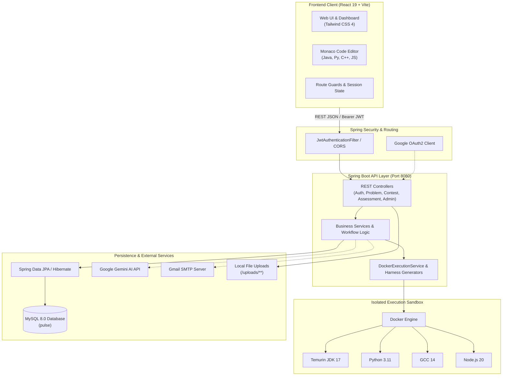
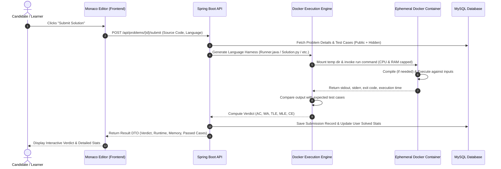

# ⚡ Pulse — Online Coding Practice & Skill Assessment Platform

<div align="center">

[](https://www.oracle.com/java/)
[](https://spring.io/projects/spring-boot)
[](https://react.dev/)
[](https://vitejs.dev/)
[](https://tailwindcss.com/)
[](https://www.mysql.com/)
[](https://www.docker.com/)
[](https://jwt.io/)

<p align="center">
  <b>An enterprise-grade, full-stack online coding practice, competitive programming, and technical skill assessment management platform with sandboxed multi-language execution and AI-assisted learning.</b>
</p>

<p align="center">
  <i>Developed as part of the <b>Infosys Springboard 7.0 Java Full Stack Internship</b></i>
</p>

---

[Key Highlights](#-key-highlights) •
[Architecture & Execution Pipeline](#-system-architecture) •
[Tech Stack](#-technology-stack) •
[Repository Structure](#-repository-structure) •
[Getting Started](#-getting-started) •
[Configuration](#-configuration--environment-variables) •
[REST API Overview](#-api-documentation) •
[Security & Proctoring](#-security--sandboxed-execution) •
[Troubleshooting](#-troubleshooting)

---

</div>

## 📌 Overview

**Pulse** is a modern, scalable web platform designed to mirror production-grade assessment ecosystems such as LeetCode, HackerRank, and Codility. It offers learners a high-performance playground to hone their Data Structures & Algorithms (DSA) skills, provides organizations and educators with an automated proctored technical evaluation pipeline, and grants platform administrators comprehensive governance tools.

### Why Pulse?
- 🔒 **Secure Sandboxed Execution:** User-submitted code runs inside isolated, resource-constrained, ephemeral Docker containers for Java, Python, C++, and JavaScript.
- ⏱️ **Real-Time Evaluation Engine:** Test-case evaluation supporting Sample and Hidden test cases with instant feedback (Accepted, Wrong Answer, Time Limit Exceeded, Runtime Error, Compilation Error).
- 🏆 **Contest & Assessment Arena:** Host timed coding challenges, invited hiring drives with OTP verification, and candidate tab-switch/violation proctoring logs.
- 🤖 **AI-Powered Mentorship:** Integrated Google Gemini assistant providing contextual hints, algorithmic approaches, and complexity analysis without spoiling final solutions.
- 📜 **Verifiable Certifications & Leaderboards:** Dynamic leaderboard rankings and automated certificate generation upon milestones and assessment completions.

---

## ✨ Key Highlights

### 👨‍💻 Learner & Candidate Experience
* **Monaco Code Editor:** VS Code-powered editor supporting syntax highlighting, smart indentation, autocompletion, multiple themes, and customizable settings.
* **Multi-Language Support:** Solve problems in **Java**, **Python**, **C++**, and **JavaScript** with pre-populated language-specific boilerplate and starter code.
* **Curated Problem Catalogue:** Filter by difficulty (*Easy*, *Medium*, *Hard*), topics/tags, completion status, and keyword search.
* **Interactive Run & Full Submission:**
  * **Run Code:** Test solutions against custom or public sample inputs.
  * **Submit Solution:** Evaluate against comprehensive hidden test cases with execution time and memory consumption metrics.
* **Detailed Editorial & Hints:** Progressive hints and algorithmic explanations to unblock learners.
* **Contest Arena:** Compete in live or upcoming coding contests with real-time scoring and rank tracking.
* **Invited Assessments:** Guest-accessible assessment session with unique invitation links, OTP verification, and time-bounded sessions.
* **Profile & Analytics:** Visual submission heatmaps, solved problems breakdown, streak tracking, and verifiable completion certificates.

### 🏢 Assessment Host & Organization Portal
* **Organization Onboarding:** Apply for organization verification with supporting documentation upload.
* **Assessment Creation Studio:** Build assessments tailored for university exams or hiring rounds:
  * Select custom or existing problem sets.
  * Set start/end windows, test durations, and passing thresholds.
  * Send bulk email invitations with secure single-use access tokens.
* **Candidate Performance Dashboard:** Review test scores, code submissions, execution metrics, and proctoring violation logs (e.g., fullscreen exits, tab switches).

### 🛠️ Administrator & Operations Studio
* **Platform Analytics Dashboard:** Real-time statistics on total registered users, active contests, problems solved, and system submissions.
* **Problem Authoring Suite:** Create and modify problems with custom parameters, sample/hidden test cases, time limits (ms), memory limits (MB), and multi-language starter codes.
* **Contest Management:** Schedule, publish, monitor, and finalize competitive programming contests.
* **Verification & Ticket Helpdesk:** Review pending organization verification requests and resolve user support tickets with a multi-turn messaging system.
* **Platform Control:** Manage user suspension statuses, roles, and global platform configuration flags.

---

## 🏛️ System Architecture

Pulse follows a clean layered enterprise architecture: **Controller ➔ Service ➔ Repository ➔ Entity**, powered by Spring Boot and React.



### ⚙️ Code Submission & Evaluation Flow



---

## 💻 Technology Stack

### Core Technologies
| Category | Technology | Version | Description |
|---|---|---|---|
| **Frontend Framework** | React | `19.2.8` | Component-based UI library |
| **Build Tool** | Vite | `8.2.0` | Next-generation frontend build tooling |
| **Styling** | Tailwind CSS | `4.3.3` | Utility-first CSS framework |
| **Code Editor** | Monaco Editor | `^4.7.0` | Embedded VS Code browser editor |
| **Icons & UI** | Lucide React / Radix UI | `^1.35.0` | Accessible component primitives and icon set |
| **Backend Framework** | Spring Boot | `4.1.0` | Enterprise Java application framework |
| **Language** | Java | `JDK 21` | Modern LTS Java runtime |
| **ORM / Persistence** | Spring Data JPA / Hibernate | Latest | Object-relational mapping and database access |
| **Database** | MySQL | `8.0+` | Relational storage for users, problems, and submissions |
| **Security** | Spring Security + JJWT | `0.12.6` | Stateless JWT token authentication and role authorization |
| **Execution Sandbox** | Docker Engine | Latest | Ephemeral isolated code evaluation containers |
| **AI Integration** | Google Gemini API | Cloud | Smart conversational AI coding assistant |
| **Email Service** | Spring Boot Starter Mail | Latest | SMTP email for assessment invites and verification |

### Sandboxed Execution Environments
| Language | Docker Image | Compiler / Runtime | Mode |
|---|---|---|---|
| **Java** | `eclipse-temurin:17-jdk` | OpenJDK 17 (`javac` & `java`) | Multi-test runner harness |
| **Python** | `python:3.11-slim` | Python 3.11.x | Script execution with sentinel splitting |
| **C++** | `gcc:14` | G++ 14 (`-O2` optimization flag) | Compiled ELF executable |
| **JavaScript** | `node:20-slim` | Node.js 20.x V8 Runtime | Asynchronous I/O execution |

---

## 📂 Repository Structure

```text
Pulse/
├── backend/                               # Spring Boot 4.1 REST API (Java 21)
│   ├── pom.xml                            # Maven build descriptor and dependencies
│   ├── .env.example                       # Gemini and server environment template
│   ├── seed_40_problems.sql               # 40 Curated DSA problems + 400 test cases
│   ├── uploads/                           # Directory for uploaded documents/files
│   └── src/
│       ├── main/
│       │   ├── java/com/infosys/pulse/
│       │   │   ├── config/                # Security, CORS, and DataInitializer setup
│       │   │   ├── controller/            # REST API controllers (30+ endpoints)
│       │   │   ├── dto/                   # Request/Response Data Transfer Objects
│       │   │   ├── entity/                # Hibernate JPA database entities
│       │   │   ├── execution/             # Docker execution engine & runner generators
│       │   │   ├── repository/            # Spring Data JPA repositories
│       │   │   ├── security/              # JWT filters, auth providers, and OAuth2
│       │   │   └── service/               # Core business services & orchestrators
│       │   └── resources/
│       │       ├── application.properties # Active Spring configuration
│       │       └── application-example.properties # Template configuration reference
│       └── test/                          # Unit and integration tests
│
├── frontend/                              # React 19 + Vite Application
│   ├── package.json                       # Scripts and NPM dependencies
│   ├── vite.config.js                     # Vite build configuration
│   ├── .env.example                       # Frontend environment template
│   ├── public/                            # Static assets and favicons
│   └── src/
│       ├── api/                           # Centralized Axios/fetch API helpers
│       ├── app/                           # App root and React Router layout
│       ├── components/                    # Reusable UI components (Navbar, Modals, Buttons)
│       ├── context/                       # Context providers (Theme, Auth, Language)
│       ├── features/                      # Modular domain features:
│       │   ├── admin/                     # Admin dashboard, problem authoring, reports
│       │   ├── assessments/               # Assessment builder, invitation, candidate arena
│       │   ├── auth/                      # Login, registration, OAuth callbacks
│       │   ├── certifications/            # Certificate viewer and generation
│       │   ├── chatbot/                   # Gemini AI conversational assistant
│       │   ├── contests/                  # Contest lobby, standings, live arena
│       │   ├── dashboard/                 # User dashboard, statistics, solved metrics
│       │   ├── leaderboard/               # Global rankings and point tables
│       │   ├── problems/                  # Problem list, detail view, Monaco editor
│       │   ├── submissions/               # Submission history and verdict inspector
│       │   ├── support/                   # Ticket raising and message thread desk
│       │   └── users/                     # Profile management and settings
│       ├── guards/                        # Protected route guards (User, Admin, Guest)
│       └── styles/                        # Global CSS and Tailwind 4 theme directives
│
└── README.md                              # Project documentation
```

---

## 🚀 Getting Started

Follow these instructions to set up and run Pulse locally on your workstation.

### Prerequisites

Ensure you have the following installed on your machine:
* **Java Development Kit (JDK) 21** or higher
* **Node.js** (v20.x or later) & **npm** (v10.x or later)
* **MySQL Server 8.0+**
* **Docker Desktop** (or Docker Engine on Linux) — *must be running for code execution*
* **Git**

---

### Step 1: Clone the Repository

```bash
git clone https://github.com/<your-username>/Pulse.git
cd Pulse
```

---

### Step 2: Pull the Execution Docker Images

Before running user submissions, Docker must have the sandbox images cached locally. Run:

```bash
docker pull eclipse-temurin:17-jdk
docker pull python:3.11-slim
docker pull gcc:14
docker pull node:20-slim
```

---

### Step 3: Database Setup

1. Start your local MySQL service.
2. Open your MySQL client (MySQL Workbench, DBeaver, or terminal) and create the database:

```sql
CREATE DATABASE pulse CHARACTER SET utf8mb4 COLLATE utf8mb4_unicode_ci;
```

---

### Step 4: Configure & Start the Backend

1. Navigate to the `backend` directory:
   ```bash
   cd backend
   ```
2. Copy the example properties to configure your database connection:
   ```bash
   cp src/main/resources/application-example.properties src/main/resources/application.properties
   ```
3. Update `src/main/resources/application.properties` with your MySQL credentials:
   ```properties
   spring.datasource.url=jdbc:mysql://localhost:3306/pulse
   spring.datasource.username=YOUR_MYSQL_USERNAME
   spring.datasource.password=YOUR_MYSQL_PASSWORD

   # Set a strong JWT secret (at least 256 bits / 32 characters)
   jwt.secret=9a8b7c6d5e4f3a2b1c0d9e8f7a6b5c4d3e2f1a0b9c8d7e6f5a4b3c2d1e0f9a8b

   # Server Port
   server.port=8080
   ```
4. Build and start the Spring Boot API:
   * **On Linux / macOS:**
     ```bash
     ./mvnw spring-boot:run
     ```
   * **On Windows (PowerShell / Command Prompt):**
     ```powershell
     .\mvnw.cmd spring-boot:run
     ```
5. The API will start on **`http://localhost:8080`**.
   * On startup, Spring Boot automatically applies Hibernate DDL (`ddl-auto=update`) and creates all database tables.
   * `DataInitializer` automatically provisions the default administrator account.

---

### Step 5: (Optional) Seed 40 DSA Problems

To load 40 DSA problems complete with test cases, constraints, starter templates, and hints, execute the SQL script in your MySQL database:

```bash
mysql -u YOUR_MYSQL_USERNAME -p pulse < seed_40_problems.sql
```

---

### Step 6: Configure & Start the Frontend

1. Open a new terminal tab and navigate to the `frontend` directory:
   ```bash
   cd frontend
   ```
2. Copy the example environment file:
   ```bash
   cp .env.example .env
   ```
   *(Ensure `VITE_API_BASE_URL` points to `http://localhost:8080` if set, or leave defaults).*
3. Install frontend dependencies:
   ```bash
   npm install
   ```
4. Start the Vite development server:
   ```bash
   npm run dev
   ```
5. Open your browser and navigate to **`http://localhost:5173`**.

---

### 🔑 Default Credentials

When the backend boots for the first time, it seeds a default administrator account:

| Role | Username | Email | Password |
|---|---|---|---|
| **System Administrator** | `admin` | `admin@gmail.com` | `Admin@123` |

> ⚠️ **Important:** For production or public deployment, change this default password immediately.

---

## ⚙️ Configuration & Environment Variables

### Backend Configuration (`backend/src/main/resources/application.properties`)

| Property | Default / Recommended | Description |
|---|---|---|
| `spring.datasource.url` | `jdbc:mysql://localhost:3306/pulse` | JDBC MySQL connection URL |
| `spring.datasource.username` | `root` | MySQL user account |
| `spring.datasource.password` | `password` | MySQL user password |
| `server.port` | `8080` | Spring Boot HTTP listening port |
| `jwt.secret` | *(Custom 256-bit secret)* | Secret key for signing and verifying JWT tokens |
| `gemini.api.url` | `https://generativelanguage.googleapis.com/...` | *(Optional)* Google Gemini endpoint |
| `gemini.api.key` | `YOUR_API_KEY` | *(Optional)* Google Gemini API key |
| `spring.mail.host` | `smtp.gmail.com` | *(Optional)* SMTP mail server host |
| `spring.mail.port` | `587` | *(Optional)* SMTP mail port |
| `spring.mail.username` | `YOUR_EMAIL` | *(Optional)* SMTP mailbox username |
| `spring.mail.password` | `YOUR_APP_PASSWORD` | *(Optional)* SMTP App Password |
| `app.frontend.url` | `http://localhost:5173` | Frontend origin for CORS and email links |
| `google.client.id` | `YOUR_GOOGLE_CLIENT_ID` | *(Optional)* Google OAuth2 Client ID |

### Frontend Configuration (`frontend/.env`)

| Variable | Default Value | Description |
|---|---|---|
| `VITE_API_BASE_URL` | `http://localhost:8080` | Backend API root URL |
| `VITE_CHATBOT_API_URL` | `/api/chat` | Chatbot proxy endpoint |
| `VITE_GOOGLE_CLIENT_ID` | *(Optional)* | Google OAuth2 Client ID for one-tap sign-in |

---

## 📡 API Documentation

All protected endpoints require an `Authorization: Bearer <JWT_TOKEN>` header.

### 🔐 Authentication (`/api/auth`)
| Method | Endpoint | Access | Description |
|---|---|---|---|
| `POST` | `/api/auth/register` | Public | Register a new learner account |
| `POST` | `/api/auth/login` | Public | Authenticate user and receive JWT |
| `POST` | `/api/auth/admin/login` | Public | Authenticate platform administrator |
| `POST` | `/api/auth/google` | Public | Authenticate via Google ID Token |

### 🧩 Problems & Code Execution (`/api/problems`)
| Method | Endpoint | Access | Description |
|---|---|---|---|
| `GET` | `/api/problems` | Public | List problems with filters (difficulty, tags) |
| `GET` | `/api/problems/{id}` | Public | Get problem details, description, and templates |
| `GET` | `/api/problems/slug/{slug}` | Public | Lookup problem by human-readable slug |
| `POST` | `/api/problems/{id}/run` | Authenticated | Execute code against sample test cases |
| `POST` | `/api/problems/{id}/submit` | Authenticated | Submit code for full evaluation against hidden cases |
| `GET` | `/api/problems/{id}/editorial` | Authenticated | Get hints and editorial solutions |

### 📊 Submissions (`/api/submissions`)
| Method | Endpoint | Access | Description |
|---|---|---|---|
| `GET` | `/api/submissions/my` | Authenticated | Get logged-in user's submission history |
| `GET` | `/api/submissions/problem/{problemId}` | Authenticated | Get user's submissions for a specific problem |
| `GET` | `/api/submissions/stats` | Authenticated | Get solved counts, acceptance rates, and analytics |

### 🏆 Contests (`/api/contests`)
| Method | Endpoint | Access | Description |
|---|---|---|---|
| `GET` | `/api/contests` | Public | List upcoming, active, and past contests |
| `GET` | `/api/contests/{id}` | Authenticated | Get contest details and problem list |
| `POST` | `/api/contests/{id}/register` | Authenticated | Register for a contest |
| `GET` | `/api/contests/{id}/leaderboard` | Public | Get live contest leaderboard |

### 📝 Skill Assessments (`/api/assessments`)
| Method | Endpoint | Access | Description |
|---|---|---|---|
| `POST` | `/api/assessments` | Host / Admin | Create a new skill assessment |
| `POST` | `/api/assessments/{id}/invite` | Host / Admin | Send email invitations to candidates |
| `POST` | `/api/public/assessment-invitations/verify-otp` | Public | Verify candidate OTP and access token |
| `POST` | `/api/assessment-session/start` | Candidate Token | Begin assessment session timer |
| `POST` | `/api/assessment-session/submit` | Candidate Token | Submit assessment solutions |
| `POST` | `/api/assessment-session/log-violation` | Candidate Token | Record tab switches / proctoring violations |

### 🏢 Organizations & Support (`/api/organizations`, `/api/support`)
| Method | Endpoint | Access | Description |
|---|---|---|---|
| `POST` | `/api/organizations/register` | Authenticated | Apply for an organization account with doc upload |
| `GET` | `/api/organizations/status` | Authenticated | Check organization application review status |
| `POST` | `/api/support/tickets` | Authenticated | Create a new support ticket |
| `GET` | `/api/support/tickets/my` | Authenticated | View current user's tickets and replies |

### 👑 Admin Management (`/api/admin`)
| Method | Endpoint | Access | Description |
|---|---|---|---|
| `GET` | `/api/admin/dashboard` | Admin | Get system metrics, stats, and activity charts |
| `POST` | `/api/admin/problems` | Admin | Create a new problem with test cases |
| `PUT` | `/api/admin/problems/{id}` | Admin | Edit problem metadata, limits, and templates |
| `POST` | `/api/admin/testcases/{problemId}` | Admin | Add test cases (inputs and expected outputs) |
| `GET` | `/api/admin/organizations` | Admin | Review pending organization requests |
| `PUT` | `/api/admin/organizations/{id}/status` | Admin | Approve or reject organization application |
| `GET` | `/api/admin/users` | Admin | List users and manage suspension flags |

---

## 🔒 Security & Sandboxed Execution

### 1. Ephemeral Containerized Sandbox
Executing untrusted code submitted by users poses severe security risks (fork bombs, disk space exhaustion, unauthorized network requests, host machine filesystem tampering). Pulse mitigates this through containerization:
* **Isolation:** Each submission runs in an ephemeral container using dedicated runtimes (`eclipse-temurin`, `python-slim`, `gcc`, `node-slim`).
* **Resource Quotas:**
  * Memory limit enforced via Docker `--memory` flags (default: 256MB / 512MB).
  * Execution timeout enforced with Java process timers (default: 2000ms - 5000ms), killing unresponsive containers.
* **Network Isolation:** Sandbox containers run without host network access (`--network none`).
* **Clean Destruction:** Containers and temporary source directories are purged immediately following test execution.

### 2. Authentication & Authorization
* **BCrypt Password Hashing:** Secure one-way hashing with salted passwords.
* **Stateless JWT Tokens:** Digitally signed JWT tokens with expiration timestamps, passed in standard HTTP `Authorization` headers.
* **Role-Based Access Control (RBAC):** Strict Spring Security authorization enforcing separation between `USER` and `ADMIN` privileges.
* **Tokenized Guest Access:** Assessment candidates receive isolated single-session tokens that grant access strictly to their designated assessment instance.

### 3. Anti-Cheat & Assessment Proctoring
* Automatic fullscreen enforcement in assessment and contest sessions.
* Real-time logging of **visibility changes** and **window blur / tab switch events**.
* Recorded violation counts displayed directly on the assessment host review dashboard.

---

## 🧪 Testing & Verification

### Running Backend Unit & Integration Tests
```bash
cd backend
./mvnw test        # On Linux / macOS
.\mvnw.cmd test    # On Windows
```

### Running Frontend Linter & Build Verification
```bash
cd frontend
npm run lint       # Run ESLint validation
npm run build      # Trigger production Vite build
```

---

## 🛠️ Troubleshooting

| Issue | Root Cause | Solution |
|---|---|---|
| **Docker execution fails with error** | Docker Desktop is not running or images are missing | Ensure Docker Desktop is active. Run `docker pull` for `eclipse-temurin:17-jdk`, `python:3.11-slim`, `gcc:14`, and `node:20-slim`. |
| **Backend fails to connect to MySQL** | Incorrect database credentials or port | Check `application.properties`. Ensure MySQL is running on port `3306` (or `3307` if customized) and database `pulse` exists. |
| **CORS errors on frontend requests** | Port mismatch or backend not running | Verify backend is running on `http://localhost:8080` and `app.frontend.url` is set to `http://localhost:5173`. |
| **Vite fails to start** | Node version incompatibility or missing packages | Ensure Node is `>= 20.0.0`. Run `rm -rf node_modules package-lock.json` followed by `npm install`. |
| **Gemini AI chatbot returns empty response** | Missing or invalid API key | Configure `gemini.api.key` in `backend/src/main/resources/application.properties` or use local fallback responses. |

---

## 👥 Contributors & Acknowledgments

* **Project:** Pulse — Online Coding Practice & Skill Assessment Management Platform
* **Internship Program:** Infosys Springboard 7.0 Java Full Stack Internship
* **Mentors & Evaluators:** Infosys Springboard Mentorship Team

---

## 📄 License

This project is licensed under the [MIT License](LICENSE) — free for educational and non-commercial development use.

<div align="center">
  <sub>Built with ❤️ by the Pulse Development Team</sub>
</div>
